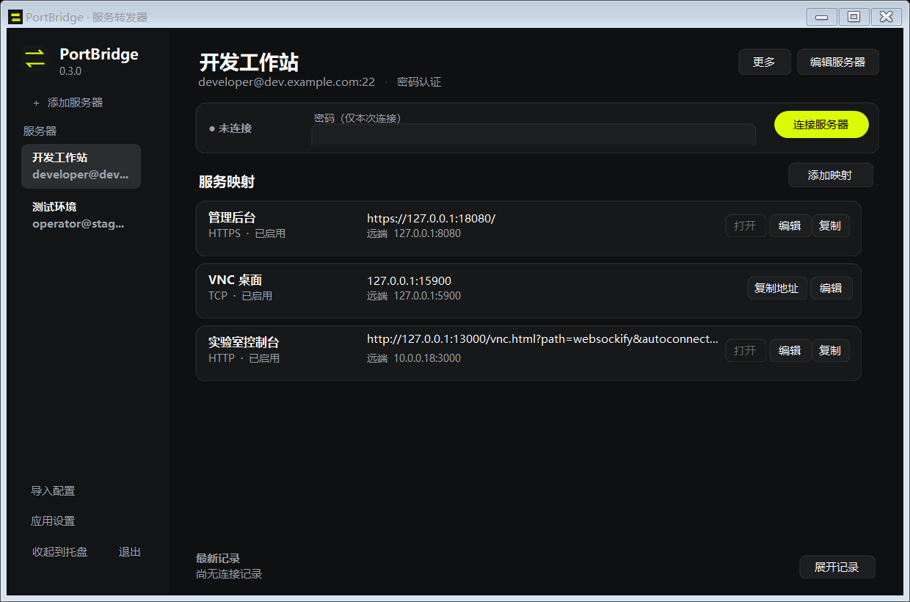

# PortBridge

PortBridge 是 Windows x64 SSH 本地端口转发器，可在本机浏览器或客户端访问 SSH 服务器所在网络中的服务。适合 Web 管理页、开发服务、数据库和 VNC 等 TCP 服务；不需要安装 OpenSSH，也不会读取 Windows SSH config。

[下载最新版 Windows x64 Setup 安装包](https://github.com/Nortea575/PortBridge/releases/latest) · [更新日志](CHANGELOG.md)



## 主要功能

- 左侧服务器列表管理连接目标；服务器和端口映射分别在独立编辑页保存或取消，工作区用于选择服务器、连接和访问服务。
- 保存多组服务器和多条映射；同一时间连接一组服务器。
- 支持 SSH 密码和私钥文件认证。密码及私钥口令在连接时输入，不保存在配置文件中。
- HTTP(S) 服务行可打开或复制入口；TCP 服务行可复制本机地址。
- 首次连接核对 SSH 服务器指纹；指纹变化时拒绝连接。
- 关闭主窗口后程序留在系统托盘，连接继续运行；可从托盘打开、断开或退出。
- 支持服务器配置导入和导出。
- 可选登录 Windows 后启动到托盘，不会自动连接 SSH。
- 可在启动时或手动检查 GitHub 最新稳定版；发现更新后可打开对应 Windows x64 Setup 下载链接，不会自动下载或安装。

## 快速开始

1. v0.3.0 通过 Setup 安装，不提供便携 ZIP。下载并运行 `PortBridge-0.3.0-Setup-x64.exe`，按向导安装。默认仅为当前用户安装到 `%LOCALAPPDATA%\Programs\PortBridge`，无需管理员权限；开始菜单入口默认创建，桌面快捷方式和登录启动可选，首次安装时登录启动默认关闭。安装完成页可选择立即启动。
2. 在左侧服务器列表选择“添加服务器”，填写名称、SSH 主机或 IP、端口、用户名和认证方式。私钥认证还需选择私钥文件。保存后，密码在连接时输入；服务器地址应为实际主机名或 IP，不是 SSH config 别名。
3. 选择“添加映射”，在独立编辑页填写名称、本地端口、目标主机、目标端口和网页路径，然后保存。服务器与映射编辑页都可以保存或取消。目标主机由 **SSH 服务器侧**访问；远端服务只监听环回地址时，通常填写 `127.0.0.1`。
4. 回到工作区，选择已保存的服务器，输入本次连接的密码或私钥口令，然后点击“连接服务器”。首次连接时核对并确认服务器指纹。
5. 连接成功后，HTTP(S) 服务行可“打开”或“复制”入口；TCP 服务行可“复制地址”，再用对应客户端连接，例如 `127.0.0.1:15900`。

例如，映射本地端口 `18080` 到 SSH 服务器可访问的 `127.0.0.1:8080` 后，可在本机浏览器打开 `http://127.0.0.1:18080/`。原生 VNC 是 TCP 服务，需使用 VNC 客户端；浏览器访问需要远端提供 noVNC 等 Web 服务。

### 从 v0.2.0 升级

先从旧版系统托盘菜单选择“退出”，再运行新的 Setup 安装包。v0.3.0 继续使用 `%LOCALAPPDATA%\PortBridge\settings.json`，无需导入旧配置。卸载程序会移除应用文件和快捷方式，但保留该配置目录；之后重新安装仍可继续使用。

## 使用说明

### 登录启动与更新

左侧“应用设置”可开启或关闭登录 Windows 时启动，也可设置启动时检查更新或手动检查。登录启动会让程序进入托盘，不会自动连接 SSH。检查更新会查询 GitHub 上的最新稳定版；发现更新后可打开对应版本的 Windows x64 Setup 下载链接（若没有安装包资产，则打开 Release 页面），由用户自行下载和运行安装包。程序不会静默下载或安装更新。网络错误或 GitHub 请求受限时，可稍后重试。

### 配置与认证

服务器和映射设置保存在 `%LOCALAPPDATA%\PortBridge\settings.json`，包括主机、用户名、私钥路径、规则和已确认的服务器指纹。私钥文件内容、密码和私钥口令不保存在配置中。导出的配置不包含私钥路径、认证秘密或指纹信任记录；其中会包含服务器地址、用户名、规则名称及网页路径，分享前请检查。导入后需要在本机重新选择私钥文件。

日志仅显示在当前窗口，不写入日志文件。首次使用时需核对服务器指纹，不复用 OpenSSH 的 `known_hosts`。若服务器重装导致指纹改变，先通过可信渠道核验新指纹；当前版本会拒绝连接，需退出程序并从 `settings.json` 的 `TrustedHosts` 中移除对应 `主机:端口` 记录，再重新连接确认。

### 限制

- 同时连接一组服务器；当前不支持自动重连。
- 仅支持 SSH 密码和私钥文件认证；不支持 SSH agent、跳板机、SSH config 导入、键盘交互式 MFA、UDP、SOCKS 或远程端口转发。
- 本地服务只监听 `127.0.0.1`，仅供本机访问；SSH 服务器需允许 TCP 转发。
- 安装包尚未进行代码签名，Windows 可能显示安全提示。

## 构建与验证

构建环境为 Windows、.NET 9 SDK 和 Inno Setup 7.1.1 x64；首次构建需要通过 NuGet 下载依赖。

```powershell
# 运行源码
dotnet run --project src/PortBridge

# 构建 Windows x64 Setup 安装包
./build.ps1

# 运行自动化验证
dotnet run --project tests/PortBridge.Tests -c Release
```

构建产物为 `dist/PortBridge-0.3.0-Setup-x64.exe`。安装包包含自包含应用程序和运行所需许可证，不包含示例服务器配置、测试或开发资料。安装后无需另行安装 .NET。

## 许可

本项目采用 MIT 许可，见 [LICENSE](LICENSE)。依赖及分发许可证见 [THIRD-PARTY-NOTICES.md](THIRD-PARTY-NOTICES.md)。
