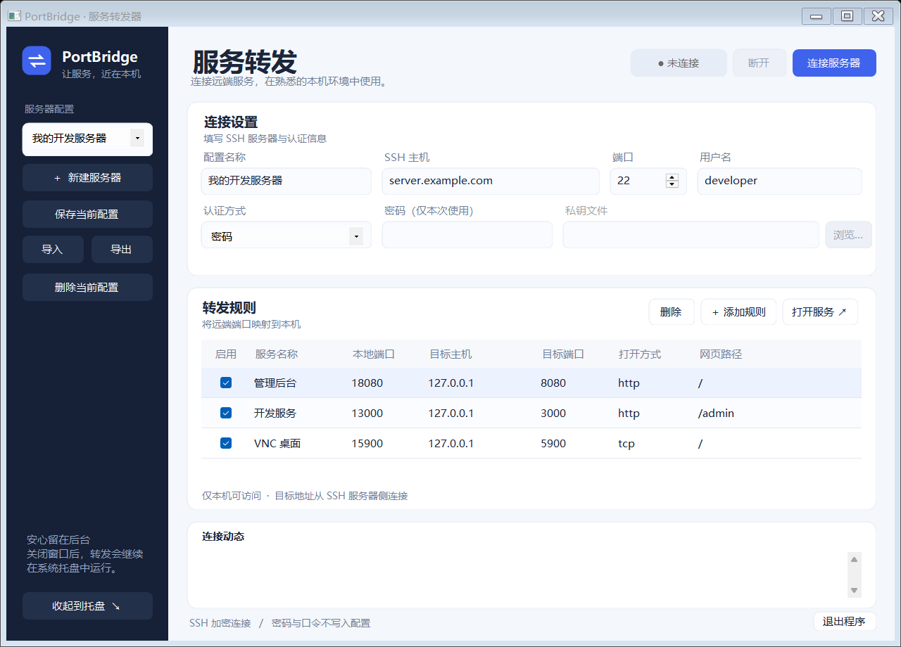

# PortBridge

一个轻量的 Windows SSH 本地端口转发器。在自己电脑的浏览器或客户端里打开远端内网服务，无需一直开着远程桌面和终端。

适合 WebUI、管理后台、开发服务器、数据库和 VNC 等 TCP 服务。基于 C#、Windows Forms 和 SSH.NET。无需安装 OpenSSH，不读取系统 SSH config。



## 功能

- 深色配置侧栏、卡片式连接设置、圆角按钮和连接状态提示。
- 保存多组服务器配置，每组可配置多条端口映射；当前版本同时连接一组服务器。
- 密码或私钥文件认证，支持带口令的私钥。
- 自定义本地端口、目标地址、目标端口和网页路径；支持 HTTP / HTTPS 网页快捷打开及普通 TCP 转发。
- 首次连接核对 SSH 服务器指纹；后续指纹变化时拒绝连接。
- 关闭主窗口后保留在托盘，连接继续运行；托盘菜单可打开、断开或退出。
- 配置导入导出。密码与私钥口令仅用于本次连接，不写入配置文件。
- 一条规则启动失败时回收本次已建立的全部转发，避免留下半连接状态。

## 使用

1. 解压 Windows x64 发布包，运行 `PortBridge.exe`。自包含版本无需另装 .NET。
2. 填写配置名称、SSH 服务器地址、端口和用户名。这里填写实际主机名或 IP，不是本机 SSH config 的别名。
3. 选择密码认证，或选择私钥文件。密码 / 私钥口令只在当前连接时使用。
4. 添加转发规则。目标主机从 **SSH 服务器侧**访问；远端服务仅监听环回地址时，通常填写 `127.0.0.1`。
5. 点击“连接”，首次连接核对并确认服务器指纹。
6. 选中 HTTP / HTTPS 规则后点击“打开选中服务”；TCP 服务用相应客户端连接 `127.0.0.1:本地端口`。

通用示例：

| 服务名称 | 本地端口 | 目标主机 | 目标端口 | 打开方式 | 网页路径 |
| --- | --- | --- | --- | --- | --- |
| 管理页面 | 18080 | 127.0.0.1 | 8080 | http | / |
| 开发服务 | 13000 | 127.0.0.1 | 3000 | http | /admin |
| VNC | 15900 | 127.0.0.1 | 5900 | tcp | / |

例如第一条映射建立后，本机浏览器打开 `http://127.0.0.1:18080/`。原生 VNC 不是 HTTP 页面，不能直接用浏览器打开；若远端已有 noVNC，转发其网页和 WebSocket 所需端口。noVNC 如需明确指定连接参数，可以在网页路径中填写 `/vnc.html?host=127.0.0.1&port=本地端口&path=websockify&autoconnect=1`。

点击窗口右上角 × 会隐藏到托盘，**不会断开连接**。点击“断开”停止转发，点击“退出”关闭软件并停止全部转发。电脑重启后需重新打开软件并连接。当前版本不自动重连、不注册开机启动。

## 配置与认证

本地设置保存于 `%LOCALAPPDATA%\PortBridge\settings.json`，包含服务器地址、用户名、私钥路径、映射规则和已确认的服务器指纹。密码、私钥口令及私钥内容不保存在其中。日志只显示在当前窗口，不写入日志文件。

“导出”只导出选中的服务器配置，不包含私钥路径、密码、私钥内容或指纹信任记录。**地址、用户名、规则名称和网页路径会导出**，分享前请自行检查；不要在网页路径中填写访问令牌。导入不会自动连接，私钥认证需要在接收电脑上重新选择私钥文件。

首次使用时核对服务器指纹，不复用 OpenSSH 的 `known_hosts`。如果服务器重装导致指纹变化，先通过可信渠道确认新指纹，再退出程序，编辑本地 `settings.json`，移除 `TrustedHosts` 中对应的 `主机:端口` 记录，然后重新连接核对。

只支持 SSH 密码和私钥文件认证；当前版本不支持 SSH agent、跳板机、SSH config 导入、键盘交互式 MFA、UDP、SOCKS 或远程端口转发。本地监听固定为 `127.0.0.1`，仅供本机访问。SSH 服务器需要允许 TCP 转发。

## 构建

环境：Windows、.NET 9 SDK。首次构建需要访问 NuGet 下载依赖。

```powershell
# 运行源码
dotnet run --project src/PortBridge

# 发布 Windows x64 自包含单文件程序及 ZIP
./build.ps1

# ARM64（需要在对应架构上另行验证）
./build.ps1 -Runtime win-arm64
```

构建输出位于 `dist/win-x64/PortBridge.exe` 和 `dist/PortBridge-win-x64.zip`。自包含程序包含运行时，体积会大于仅发布业务代码的版本。发布程序未做代码签名。

## 验证

```powershell
# 配置、端口校验、URL 与持久化检查
dotnet run --project tests/PortBridge.Tests -c Release

# 额外生成实际 WinForms 界面截图（需要交互式 Windows 桌面）
dotnet run --project tests/PortBridge.Tests -c Release -- --render
```

实机集成检查从环境变量读取测试服务器，测试拒绝未信任指纹、私钥登录、多端口 HTTP 转发、断开释放端口以及端口冲突回滚。应对自己有权访问的测试服务器运行；`PORTBRIDGE_TEST_PORTS` 至少需要两个可正常响应的 HTTP 服务端口。

```powershell
$env:PORTBRIDGE_TEST_HOST = 'your-test-host'
$env:PORTBRIDGE_TEST_USER = 'your-test-user'
$env:PORTBRIDGE_TEST_KEY = 'C:\path\to\private-key'
$env:PORTBRIDGE_TEST_FINGERPRINT = 'SHA256:your-verified-fingerprint'
$env:PORTBRIDGE_TEST_PORTS = '8080,3000'
dotnet run --project tests/PortBridge.Tests -c Release -- --integration
```

## GitHub 发布

仓库应包含 `src/`、`tests/`、`examples/`、`docs/`、`licenses/`、`.github/`、`build.ps1`、README、许可证和第三方声明。`bin/`、`obj/`、`dist/` 及本地设置已由 `.gitignore` 排除。上传发布包时使用 GitHub Releases，源码通过正常 Git 提交上传即可。

仓库内仅附通用示例，不包含真实服务器配置或任何密钥。提供 GitHub Actions 构建检查和发布工作流。向 main 提交 release-version.txt 的版本变更，会先运行检查、构建 Windows 包，再创建对应版本的 GitHub Release；也可在 Actions 中手动运行 Publish release。release-version.txt 必须与项目版本一致，已有 Release 不会被覆盖。

## 许可

MIT，见 [LICENSE](LICENSE)。依赖及分发许可证见 [THIRD-PARTY-NOTICES.md](THIRD-PARTY-NOTICES.md)。
